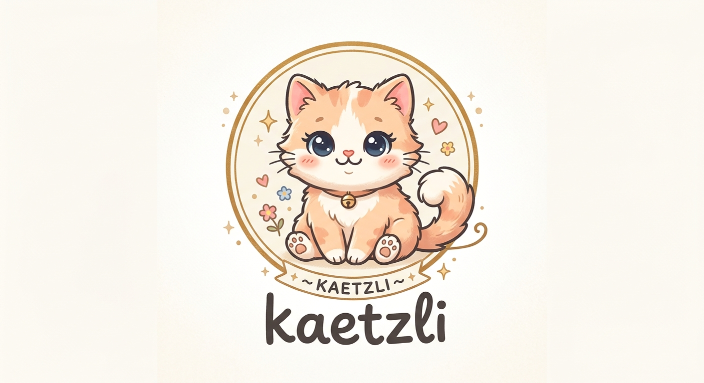

# kaetzli 🐱

The name is Swiss German for a little cat (Kätzli), with the -li ending a nod to other open source projects.

kaetzli builds a small Linux system for virtual machines and containers. Packages
are built from pinned source archives, assembled into a read-only EROFS disk image, and
published as an OCI image. Optional systemd extensions add Podman, Kubernetes, and debugging
tools without changing the base image.



The project targets QEMU and Firecracker on Linux, and Apple's Virtualization.framework on
Apple silicon. The EROFS image is a read-only filesystem, not a self-booting disk: a VM
launcher supplies the matching kernel and command line. It is built from pinned source
archives with a pinned Debian builder toolchain; it is not a self-hosting Linux From Scratch
build. The base includes systemd, glibc, bash, coreutils, networking tools, and the
container-runtime components needed by `crun`. It has no package manager and does not target
physical hardware.

## Images and extensions

| Artifact | Contents |
| --- | --- |
| `output/rootfs.erofs` and `output/rootfs.cmdline` | Read-only EROFS root with a dm-verity hash tree; keep the files together. |
| `output/kaetzli-oci.tar` | OCI image of the userspace, without a kernel or systemd. |
| `output/extensions/*.raw` | Optional system extensions, including Podman, Kubernetes, and debugging tools. |
| `output/confexts/*.raw` | Configuration extensions used with the corresponding system extension. |

The disk root is verified by dm-verity at read time. `/var`, `/tmp`, and `/run` are
temporary filesystems by default. `/home` and `/root` point into `/var`; attach a writable
`/var` disk when state must survive reboot. The `vm.sh` workflow creates and manages one
for each VM.

Green builds of `main` are published as [releases](https://github.com/fwilhe2/kaetzli/releases):
rolling snapshots of these files for both architectures, with SBOMs and `SHA256SUMS`,
kept for at least 37 days. Each release's notes show how to boot it with QEMU.

System extensions are EROFS images merged by systemd-sysext at boot; configuration
extensions use systemd-confext. Extensions attached by the VM tools are read-only and
dm-verity verified. Extensions installed under `/var` are not verified.

## Quick start

On Linux, with QEMU installed, the launcher is one file and needs no checkout:

```sh
curl -fLo ~/.local/bin/kaetzli \
  https://github.com/fwilhe2/kaetzli/releases/latest/download/kaetzli-$(uname -s | tr A-Z a-z)-$(uname -m)
chmod +x ~/.local/bin/kaetzli
kaetzli start --ext podman
kaetzli ssh
```

It downloads and verifies the latest snapshot, keeps each machine's `/var`, and has
`vm.sh`'s commands (`start`, `ssh`, `console`, `stop`, `list`, `info`, `update`, `rm`).

From a checkout, `tools/vm.sh` does the same and more. Fetch the latest snapshot and start
the default VM with Podman:

```sh
./tools/vm.sh update
./tools/vm.sh start --image ci --ext podman
```

Connect as the unprivileged `user` account, then run a rootless container:

```sh
./tools/vm.sh ssh
podman run --rm docker.io/library/alpine:latest echo hello from kaetzli
```

The VM keeps its `/var` data when stopped. Exit the shell and stop it with
`./tools/vm.sh stop`. Commands use the default machine automatically; `vm.sh` verifies
downloaded images before installing them. See [Machines](#machines) to manage more VMs.

The published OCI image can also run under Podman or Docker. It has no package manager;
see [`examples/nginx`](examples/nginx/README.md) for an image built on top of kaetzli.

## Host requirements

The project builds and publishes `amd64` and `arm64` OCI images. Building from source
requires Podman. Fetching a snapshot needs only `curl`; a CI run's artifacts
(`fetch-image.sh --run`) need an authenticated GitHub CLI (`gh`). QEMU runs
with or without KVM, though KVM is recommended. Firecracker requires KVM on Linux;
Virtualization.framework support is for Apple silicon. The Kubernetes demo requires KVM and
about 8 GB of RAM.

## Build

Build all packages and assemble both image formats:

```sh
./tools/build-image.sh
```

The build requires Podman and runs package builds in the repository's builder image. Each
package is declared in `packages/<name>/env.sh` and built by `packages/<name>/build.sh`.
Package archives are pinned by version and checksum. Package compilation runs without
network access. See [How the build works](docs/guides/how-it-works.md) for the build flow
and [Build inputs](docs/guides/build-container.md) for the builder and source images.

Useful variants:

```sh
./tools/build-image.sh --image-only       # assemble from the existing rootfs/
./tools/build-image.sh --flavour erofs    # assemble only the disk image
./tools/build-image.sh --only strace      # build one package, then assemble
./build.sh strace                         # build one package into staging/
./tools/clean.sh                           # remove rebuildable build output
```

Build products are written under `output/`; package staging is under `staging/`, with the
merged filesystem under `rootfs/`. The default clean removes rebuildable output but keeps
source downloads and VM disks; see `./tools/clean.sh --help` for options.

To add local files, pass a directory laid out like the target filesystem with `--extra`:

```sh
./tools/build-image.sh --image-only --extra extra
```

Only new files under `usr/`, `etc/`, or `opt/` are accepted; security-sensitive paths and
privileged files are rejected. Added files are listed in build output, a hash manifest, and
the SBOM. Add software built from source as a package.

For build details, see the [documentation index](docs/README.md).

## Disk image behavior

- **Immutable root:** EROFS is mounted read-only, and dm-verity checks blocks against the
  root hash in `rootfs.cmdline`. A mismatch causes an I/O error.
- **Ephemeral state by default:** `/var`, `/tmp`, and `/run` are tmpfs. A VM can attach a
  disk for `/var`; systemd formats a blank disk and grows its filesystem when the disk is
  enlarged.
- **SSH keys only:** accounts have no passwords and sshd accepts keys. `vm.sh` creates and
  keeps a key for each VM.
- **Hardened binaries:** every package is compiled with a stack protector,
  `_FORTIFY_SOURCE=3`, stack clash protection and full RELRO; dynamically linked
  executables are PIE.
- **Networking:** systemd-networkd and systemd-resolved provide guest networking. The base
  includes `ip`, `ping`, and `curl` for inspection and connectivity checks.

See [Debugging](docs/guides/debugging.md) for console and log details.

## Machines

`tools/vm.sh` manages QEMU machines under `output/vms/`. Each has its own `/var` disk,
machine ID, SSH key, and image. The default machine is `kaetzli`; add a name when you want
more than one. Image updates are picked up on the next start.

```sh
./tools/vm.sh start dev --ext podman --mem 4096 --size 20G
./tools/vm.sh ssh dev podman run --rm docker.io/library/alpine:latest echo hello
./tools/vm.sh snapshot dev before-change
./tools/vm.sh stop dev
./tools/vm.sh update
./tools/vm.sh restart dev
./tools/vm.sh list
```

`ssh` runs as the unprivileged `user` by default; use `--root` for administration. `stop`
keeps the machine and its data. `snapshot`, `restore`, and `resize` manage its `/var` disk.
Use `./tools/vm.sh --help` for commands.

## System extensions

Extensions add software to a machine without rebuilding the base. The repository provides
`podman`, `kubernetes`, and `debug` extensions. Attach one or more at boot with
`--ext podman,debug` when starting a VM.

Podman includes Quadlet and rootless container support. The Kubernetes extension includes
kubelet, kubeadm, kubectl, CRI-O, crictl, and CNI plugins. A Kubernetes node needs persistent
storage for `/var`. To start the included three-node demo:

```sh
./tools/k8s-demo.sh up
./tools/k8s-demo.sh kubectl get pods -A
./tools/k8s-demo.sh down
```

The demo requires KVM, about 8 GB of RAM, and access to `registry.k8s.io` and `ghcr.io`.
[System extensions](docs/guides/sysext.md) explains how extensions are built, attached,
and verified. The
[documentation index](docs/README.md) links to build guides and design proposals.

## Verification and maintenance

CI builds both architectures and checks image contents, dependencies, licenses, symbols,
kernel configuration, boot behavior, containers, extensions, and byte-for-byte image
assembly reproducibility. It also reports known CVEs from the SBOMs; that scan is
observational and does not gate the build. Kubernetes cluster and node-conformance jobs run
separately and do not gate the required CI result. The main branch publishes a multi-arch
OCI image as `latest` and by commit. Run an individual test with the image and kernel paths
it requires, for example:

```sh
./test/podman.py output/rootfs.erofs rootfs/boot/bzImage
```

Every build on main signs what it publishes: the OCI images get a SLSA provenance and
their SBOM, and each boot bundle file gets a provenance (disk image, command line,
kernel, extensions). To check that a file or image came from this repository's CI and
which commit built it:

```sh
gh attestation verify oci://ghcr.io/fwilhe2/kaetzli/kaetzli:latest -R fwilhe2/kaetzli
gh attestation verify output/boot-image/rootfs.erofs -R fwilhe2/kaetzli
```

`tools/fetch-image.sh` checks the bundle's signature itself; `REQUIRE_ATTESTATION=1`
makes it refuse a run that has none.

`./tools/check-updates.py` checks pinned package versions, vendored second tarballs and
upstream patch series. `./tools/bump-version.sh <package> <version>` updates a package pin
and checksum. The update workflow opens pull requests for available updates at 17:00 UTC,
and those whose CI is green are merged between 20:00 and 05:00 UTC. Label one `hold` to
keep it out; closing it only skips that night.

A package can carry patches in `packages/<name>/patches/`; `./tools/check-patches.sh`
tests in seconds whether they apply. See [Patches](docs/guides/patches.md).

To add a package, create `packages/<name>/env.sh` and `packages/<name>/build.sh`; declare
its version, source URL, checksum, and license in `env.sh`. See `CLAUDE.md` for build-system
constraints and common pitfalls.
